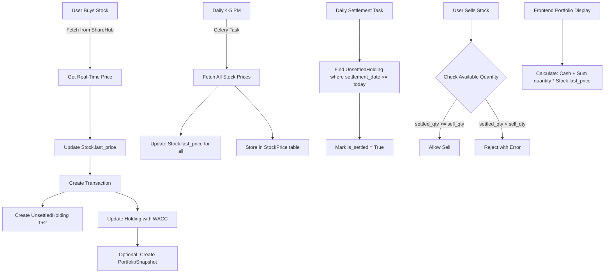

# Portfolio Timeseries Data Research & Analysis
## NEPSE Normal Mode (Delivery Trading) Implementation

## Executive Summary

This research document analyzes portfolio timeseries requirements for your NEPSE paper trading system focusing on **NEPSE Normal Mode (Delivery Trading)** only:
- **T+2 Settlement Cycle**: Shares cannot be sold until 2 business days after purchase
- **Transaction-Based Snapshots**: Portfolio value captured after every trade
- **End-of-Day Updates**: Stock prices fetched daily (4-5 PM or 10 PM) and stored in timeseries

---

## 🔴 CRITICAL CLARIFICATIONS (Addressing Your Comments)

### Your Comment #1: "System fetches data and stores in DB, data used for users"
**Understood**: You have a centralized stock price database. All users share the same `StockPrice` timeseries data (fetched from ShareHub Nepal). This is CORRECT architecture.

**What I meant by "data bloat"**: I was referring to creating 5-minute **portfolio snapshots** (not stock prices). With your clarification, here's the revised understanding:

| Data Type | Granularity | Storage | Who Uses |
|-----------|-------------|---------|----------|
| **Stock Prices** (StockPrice table) | Every minute during market hours | Centralized (1 copy) | All users share |
| **Portfolio Snapshots** (PortfolioSnapshot table) | TBD (this research) | Per-user | Individual users |

✅ **Stock price 5-minute data**: Fine if you're already fetching
❌ **Portfolio snapshot 5-minute data**: Still unnecessary (discussed below)

### Your Comment #2: "I don't want technical charts of stock or index"
**Clarification**: No candlestick charts, no technical analysis indicators (RSI, MACD, etc.).

**What you might want**:
- ✅ Simple portfolio value line chart (total money over time)
- ✅ Profit/Loss summary
- ❌ Stock technical analysis charts

### Your Comment #3: Portfolio Snapshot - "Do we even need it?"
**Your Insight**: "There is already `Holding` with WACC. When price fluctuates, it changes on frontend in real-time during trading hours, but database updates at end of day. When user buys/sells during trading hours, fetch from ShareHub and store."

**Analysis of Your Approach**:

**Option A: Your Suggested Approach (No PortfolioSnapshot)**
```python
# No PortfolioSnapshot table needed!

# Frontend calculates portfolio value in real-time:
def get_portfolio_value(user):
    holdings = Holding.objects.filter(user=user)
    total_value = user.cash_balance
    
    for holding in holdings:
        # Use Stock.last_price (updated daily at 4-5 PM)
        total_value += holding.quantity * holding.stock.last_price
    
    return total_value

# When user buys/sells during trading hours:
def buy_stock(user, symbol, quantity):
    # 1. Fetch CURRENT price from ShareHub API (real-time)
    current_price = fetch_from_sharehub_realtime(symbol)
    
    # 2. Update Stock.last_price in DB
    stock.last_price = current_price
    stock.save()
    
    # 3. Create transaction & holding
    # ... normal buy logic ...
    
    # NO PortfolioSnapshot creation!
```

**Pros of Your Approach**:
- ✅ **Simpler**: No extra table to maintain
- ✅ **Real-Time**: Portfolio value always calculated from current prices
- ✅ **Less Storage**: No historical snapshots stored
- ✅ **Accurate**: Uses actual holding quantities + latest prices

**Cons of Your Approach**:
- ❌ **No History**: Cannot show "portfolio value on Feb 1st was X"
- ❌ **No Charts**: Cannot draw portfolio performance graph over time
- ❌ **Lost Data**: If stock price changes, you lose what portfolio was worth yesterday

**Option B: Hybrid (Minimal PortfolioSnapshot)**
```python
# Only create snapshot when it matters:

def buy_stock(user, symbol, quantity):
    # ... buy logic ...
    
    # Create snapshot ONLY on transaction (not daily)
    create_portfolio_snapshot(user)  # Captures value at this moment

# NO daily snapshot task needed
```

**Verdict**: 
- If you want **portfolio history charts** → Need `PortfolioSnapshot` (at minimum on transactions)
- If you **DON'T need charts** → Your approach is perfect, skip `PortfolioSnapshot` entirely

**My Recommendation**: Keep transaction-based snapshots (minimal cost, enables future charts).

### Your Comment #4: Stock Price & Portfolio Update Strategy  
**Your Clarification**: "For all stock timeseries, when trade happens, add that value in DB only for that day. At end of day, use last fetch to update REAL stock timeseries data."

**Understanding Your Strategy**:
1. **During Trading (Intraday)**: Fetch price → Use for execution → Update `Stock.last_price` (in-memory, no timeseries record)
2. **End of Day (4-5 PM)**: Official fetch → Store in `StockPrice` table (permanent timeseries)

**Why This Makes Sense**:
- ✅ **Clean Timeseries**: One official record per day (end-of-day close price)
- ✅ **No Duplicate Data**: Intraday fetches don't pollute timeseries table
- ✅ **Accurate Trades**: Users still get real-time execution prices
- ✅ **Historical Charts**: Stock charts use clean end-of-day data

**Revised Implementation**:

```python
# ============================================
# TIER 1: Intraday Price Fetch (During Trading Hours)
# Purpose: Get accurate execution price for trades
# Storage: Updates Stock.last_price ONLY (no StockPrice record)
# ============================================

def buy_stock(user, symbol, quantity):
    """
    User buys stock during trading hours.
    Fetch current price for execution, but DON'T create timeseries record.
    """
    # 1. Fetch current price from ShareHub (real-time)
    current_data = fetch_from_sharehub_realtime(symbol)
    
    # 2. Update Stock.last_price (temporary, for current session)
    stock = Stock.objects.get(symbol=symbol)
    stock.last_price = current_data['ltp']  # Last Traded Price
    stock.save()  # ← Updates ONLY the Stock table, NOT StockPrice
    
    # 3. Execute trade at this price
    Transaction.objects.create(
        user=user,
        stock=stock,
        price=current_data['ltp'],  # Trade executed at real-time price
        # ...
    )
    
    # 4. Update Holding with WACC
    # ... (your existing logic)


# ============================================
# TIER 2: End-of-Day Batch Update (Official Timeseries)
# Purpose: Create permanent historical stock price records
# Storage: Creates StockPrice records (TimescaleDB)
# ============================================

@periodic_task(crontab(hour=16, minute=30, day_of_week='0-3'))  # 4:30 PM, Sun-Thu
def create_daily_stock_timeseries():
    """
    Official end-of-day stock price update.
    This is the ONLY place that creates StockPrice timeseries records.
    """
    today = timezone.now().date()
    
    for stock in Stock.objects.filter(is_active=True):
        # Fetch official closing data from ShareHub
        price_data = fetch_from_sharehub(stock.symbol)
        
        # Update Stock.last_price with official close
        stock.last_price = price_data['close']  # Official closing price
        stock.save()
        
        # Create ONE official timeseries record per day
        StockPrice.objects.create(
            stock=stock,
            timestamp=timezone.now(),
            date=today,
            open=price_data['open'],
            high=price_data['high'],
            low=price_data['low'],
            close=price_data['close'],  # ← This is the official price for charts
            volume=price_data['volume'],
            # ... other fields
        )
        
    logger.info(f"Created daily StockPrice records for {Stock.objects.count()} stocks")
```

**Data Flow Visualization**:

```
11:30 AM - User buys NABIL
    ↓
Fetch from ShareHub (LTP = ₹870)
    ↓
Stock.last_price = ₹870 (updated)
    ↓
Transaction created at ₹870
    ↓
[NO StockPrice record created] ✓

2:00 PM - Another user buys NABIL  
    ↓
Fetch from ShareHub (LTP = ₹875)
    ↓
Stock.last_price = ₹875 (updated again)
    ↓
Transaction created at ₹875
    ↓
[NO StockPrice record created] ✓

4:30 PM - End of Day Batch
    ↓
Fetch from ShareHub (Close = ₹872)
    ↓
Stock.last_price = ₹872 (final update)
    ↓
StockPrice.create(close=₹872) ← ONLY official record
    ↓
[Timeseries table has 1 clean record for today] ✓
```

**Benefits of Your Approach**:
- ✅ **Clean Timeseries**: `StockPrice` table has exactly 1 record per stock per day
- ✅ **Accurate Execution**: Trades use real-time prices (fetched on-demand)
- ✅ **No Data Pollution**: Intraday fluctuations don't create noisy timeseries
- ✅ **Standard Charts**: Stock historical charts use official end-of-day data (like real brokers)

**What Gets Stored Where**:

| Data | Storage Location | Update Frequency |
|------|-----------------|------------------|
| **Current Price** | `Stock.last_price` | Intraday (on trades) + End-of-day |
| **Historical OHLC** | `StockPrice` table | Once per day (end-of-day ONLY) |
| **Trade Execution Price** | `Transaction.price` | On each trade (uses `Stock.last_price` at that moment) |

**Verdict**: ✅ **This is the professional approach!** Major brokers do the same - intraday prices for execution, end-of-day for official records.

### Your Comment #4: "Why UnsettledHolding model??"
**Short Answer**: To prevent users from selling shares they bought today (NEPSE T+2 rule).

**Without UnsettledHolding model**:
```python
# BAD: User can sell immediately
Day 1: Buy 100 NABIL → Holding.quantity = 100
Day 1 (1 hour later): Sell 100 NABIL → SUCCESS (WRONG! Shares not settled yet)
```

**With UnsettledHolding model**:
```python
# GOOD: Tracks settlement status
Day 1: Buy 100 NABIL → Holding.quantity = 100, UnsettledHolding(100, settles Day 3)
Day 1: Try sell 100 NABIL → ERROR: "0 shares available (100 unsettled until Day 3)"
Day 3: Settlement job runs → UnsettledHolding marked settled
Day 3: Sell 100 NABIL → SUCCESS
```

**Alternative Without New Model** (if you prefer simpler approach):
Add fields to `Holding` model instead:
```python
class Holding(models.Model):
    # existing fields...
    settled_quantity = models.PositiveIntegerField(default=0)
    unsettled_quantity = models.PositiveIntegerField(default=0)
    # Total quantity = settled + unsettled
```

**Pros/Cons**:
- ✅ Simpler (no new model)
- ❌ Harder to track WHICH purchases settle WHEN (if user buys on multiple days)
- ❌ Can't show "30 shares settle tomorrow, 20 settle day after"

**My Recommendation**: If you want **realistic demo**, use `UnsettledHolding`. If you want **simple MVP**, use settled/unsettled fields in `Holding`.

---

## 1. NEPSE Normal Mode: Implementation Focus

### 1.1 What is Normal Mode (Delivery Trading)?

**Normal Mode** is standard share trading where:
- You buy shares with **full payment** upfront
- Shares are **delivered to your Demat account** after T+2 settlement
- You **hold shares** for days/weeks/months (long-term investment)
- **Cannot sell immediately** - must wait for T+2 settlement
- **No short selling** allowed in NEPSE

### 1.2 T+2 Settlement Cycle (NEPSE Calendar)

> [!IMPORTANT]
> **NEPSE Trading Days**: Sunday-Thursday (5 days)
> **Friday**: Settlement processing ONLY (no trading), unless it's a holiday
> **Saturday**: Holiday (no trading, no settlement)

**Settlement Calculation Rules**:
1. Count **2 business days** from trade date (T)
2. **Include Friday** for counting (settlement happens on Friday)
3. **Skip Saturday** (holiday)

**Examples**:

```python
# Example 1: Buy on Sunday (T)
Sunday (T): Buy 100 NABIL at 11:30 AM
Monday (T+1): Settlement processing
Tuesday (T+2): Shares credited to Demat
Wednesday onwards: CAN SELL ✅

# Example 2: Buy on Thursday (T) 
Thursday (T): Buy 100 NABIL
Friday (T+1): Settlement processing (no trading, but counts as business day)
Sunday (T+2): Shares credited to Demat  
Monday onwards: CAN SELL ✅

# Example 3: Buy on Wednesday (T)
Wednesday (T): Buy 100 NABIL
Thursday (T+1): Settlement processing
Friday (T+2): Shares credited (settlement day, counts!)
Sunday onwards: CAN SELL ✅

# Example 4: Friday is Holiday
Thursday (T): Buy 100 NABIL
Friday: HOLIDAY (skip this day)
Sunday (T+1): Settlement processing
Monday (T+2): Shares credited
Tuesday onwards: CAN SELL ✅
```

**Implementation Logic**:
```python
def calculate_settlement_date(trade_date):
    """
    NEPSE T+2: Add 2 business days.
    Business days = Sunday-Friday (exclude Saturday only)
    Friday counts for settlement even though no trading.
    """
    settlement_date = trade_date.date()
    business_days_added = 0
    
    while business_days_added < 2:
        settlement_date += timedelta(days=1)
        
        # Skip Saturday ONLY (weekday() == 5, where Sunday=6, Monday=0)
        if settlement_date.weekday() != 5:  
            business_days_added += 1
            
        # TODO: Also skip public holidays from holiday calendar
    
    return settlement_date
```

**Portfolio Impact**:
```python
# Sunday: Holding shows 100 NABIL (UNSETTLED - cannot sell)
# Monday: Still unsettled (T+1)  
# Tuesday: SETTLED - shares now available to sell
```

### 1.3 Why Normal Mode Only?

> [!NOTE]
> **Decision:** Implementing **Normal Mode Only** for college project.

**Reasons**:
1. ✅ **Simpler Implementation**: Single trading flow, easier to demo
2. ✅ **Educational Value**: Students learn real NEPSE settlement rules
3. ✅ **Realistic**: Matches how most retail investors trade
4. ✅ **Manageable Scope**: Achievable within project timeline
5. ⚠️ **Intraday Mode**: Too complex (requires position tracking, auto-square-off at 3 PM, margin calculations)

---

## 2. Current State Analysis

### 1.1 Existing Models

#### Portfolio Models (Already Implemented)
- **`Holding`**: Tracks current stock ownership (user, stock, quantity, average_buy_price)
- **`PortfolioSnapshot`**: Stores historical portfolio value snapshots (user, timestamp, total_value, cash_balance, investment_value)
- **`WatchlistGroup`** & **`WatchlistItem`**: Watchlist management

#### Trading Models (Already Implemented)
- **`Order`**: Buy/sell orders with status tracking (PENDING, EXECUTED, CANCELLED, REJECTED)
- **`Transaction`**: Executed trades with financial details (price, fees, WACC, realized P/L)

#### Stock Models (Already Implemented)
- **`Stock`**: Company information with current price snapshot
- **`StockPrice`** (TimescaleDB hypertable): Historical stock prices with timestamp, OHLC, volume
- **`MarketIndex`**: NEPSE index tracking

### 1.2 Current API Endpoints (Portfolio App)
Based on `portfolio_app/views.py` analysis:
- ✅ `GET /api/portfolio/` - Portfolio summary with holdings
- ✅ `GET /api/portfolio/holdings/` - Current holdings list
- ✅ `POST /api/portfolio/buy/` - Buy stock
- ✅ `POST /api/portfolio/sell/` - Sell stock
- ✅ `GET /api/portfolio/history/` - Portfolio value history (`PortfolioSnapshot`)
- ✅ `GET /api/portfolio/past-holdings/` - Sold positions
- ✅ `GET /api/portfolio/transactions/{symbol}/` - Stock transaction history
- ✅ Watchlist CRUD operations

### 1.3 Data Already Using TimescaleDB
- `stocks_stockprice` - Stock price history (hypertable)
- `portfolio_portfoliosnapshot` - Portfolio value over time (likely intended as hypertable)
- `market_data_marketindex` - Index value history (hypertable)

---

## 3. Critical Missing Features: NEPSE Business Logic

### 2.1 NEPSE T+2 Settlement Cycle ⚠️ **CRITICAL GAP**

> [!IMPORTANT]
> **Current Issue**: Your system allows immediate re-selling of purchased stocks, which is **unrealistic** for NEPSE trading.

#### Real NEPSE Settlement Rules
Based on research, NEPSE operates on a **T+2 settlement cycle**:
- **Day T (Trade Date)**: User places buy order
- **Day T+1**: Broker clearing, e-DIS processing
- **Day T+2**: Shares credited to buyer's Demat account
- **Availability**: Typically sellable on T+3 (or effectively late T+2, but safer to assume T+3/next trading day for simplicity).

**Holding Period Restriction**: Shares cannot be sold until **settlement is complete**.

#### What You're Missing
```python
# ❌ Current behavior (WRONG)
Day 1: Buy NABIL
Day 1: Sell NABIL (ALLOWED!)

# ✅ Correct NEPSE behavior
Day 1 (Monday): Buy NABIL
Day 2 (Tuesday): T+1 (wait)
Day 3 (Wednesday): T+2 (Settlement Day - shares arrive)
Day 4 (Thursday): Available to Sell (Safest assumption)
# OR available late Wednesday depending on broker speed
```

#### Impact on Demo
For college demonstration, **this is a critical demo-killer** if not implemented:
- **Professor Question**: "Why can students sell shares immediately?"
- **Realism**: Paper trading should mimic real rules
- **Complexity**: Adds educational value

### 2.2 Trading Hours Validation

NEPSE Trading Hours: **Sunday-Friday, 11:00 AM - 3:00 PM Nepal Time**

Your system should:
- ✅ Allow orders during trading hours
- ✅ Queue or reject orders outside trading hours

---

## 4. Do You Need Timeseries Data for Portfolio?

### 3.1 Current Implementation Assessment

**Already Have:**
- ✅ `PortfolioSnapshot` model for historical portfolio value
- ✅ Endpoint to fetch portfolio history: `GET /api/portfolio/history/`
- ✅ Frontend service method: `portfolioService.getHistory()`

**Analysis**: You **already have timeseries infrastructure** for portfolio! The `PortfolioSnapshot` table tracks portfolio value over time.

### 3.2 What's Currently Missing

#### A. Portfolio Snapshot Creation Logic
**Question**: How and when are `PortfolioSnapshot` records created?

Current options:
1. **Celery periodic task**: Daily snapshot at market close
2. **On-demand**: Create snapshot after each transaction
3. **Hybrid**: Daily snapshots + snapshots on significant events

**Recommendation for Demo**:
```python
# Option: Create snapshot on every transaction
# Pros: Real-time portfolio history, impressive for demo
# Cons: More database writes, but TimescaleDB handles this well

# Implementation in views.py (add after buy/sell transaction)
def create_portfolio_snapshot(user):
    # calculate total value
    PortfolioSnapshot.objects.create(...)
```

#### B. Portfolio Timeseries Charts (Frontend)
**Current**: Frontend calls `getHistory()` but needs chart implementation.
**Need**: Portfolio value chart over time (line chart).

---

## 4. Data Strategy: Stock Prices vs Portfolio Snapshots

### 4.1 Two Different Data Streams

**IMPORTANT**: Separate these two concepts:

| Data Type | What It Is | When Updated | Storage |
|-----------|-----------|--------------|---------|
| **Stock Prices** | Market price of each stock (OHLC) | Daily (4-5 PM or 10 PM) | `StockPrice` table (TimescaleDB) |
| **Portfolio Snapshots** | User's total portfolio value | On every trade | `PortfolioSnapshot` table (TimescaleDB) |

### 4.2 Stock Price Update Strategy

**Daily End-of-Day Fetch**:
```python
# Celery Task runs at 4-5 PM (after market close) or 10 PM
@periodic_task(crontab(hour=16, minute=30, day_of_week='0-4'))  # 4:30 PM, Sun-Thu
def fetch_daily_stock_prices():
    """
    Fetch latest stock prices from ShareHub Nepal.
    Updates Stock.last_price for all active stocks.
    Stores historical OHLC data in StockPrice table.
    """
    for stock in Stock.objects.filter(is_active=True):
        # Fetch from ShareHub API
        price_data = fetch_from_shareshub(stock.symbol)
        
        # Update current price
        stock.last_price = price_data['close']
        stock.save()
        
        # Store historical data
        StockPrice.objects.create(
            stock=stock,
            timestamp=timezone.now(),
            open=price_data['open'],
            high=price_data['high'],
            low=price_data['low'],
            close=price_data['close'],
            volume=price_data['volume']
        )
```

**Why NOT Every 5 Minutes?**
- ❌ NEPSE market is only open 4 hours (11 AM - 3 PM)
- ❌ For paper trading, real-time prices not critical
- ❌ ShareHub API may have rate limits
- ✅ End-of-day prices sufficient for educational demo

### 4.3 Portfolio Snapshot Strategy

**Transaction-Based Snapshots** (Recommended):
```python
# In BuyStockView and SellStockView
def post(self, request):
    with transaction.atomic():
        # ... execute trade logic ...
        
        # Create portfolio snapshot immediately
        create_portfolio_snapshot(request.user)
```

**Why Transaction-Based?**
- ✅ **Perfect for Demo**: Every trade creates visible data point on chart
- ✅ **Simple**: No complex background jobs needed
- ✅ **Accurate**: Captures exact portfolio value at trade execution
- ✅ **Lightweight**: Only creates snapshots when user actually trades

**Optional: Daily Snapshots for Inactive Users**
```python
# Optional Celery Task - only if you want charts for non-traders
@periodic_task(crontab(hour=16, minute=45, day_of_week='0-4'))
def create_daily_portfolio_snapshots():
    """
    For users with holdings who didn't trade today,
    create a snapshot to show passive price changes.
    """
    users_with_holdings = User.objects.filter(
        holdings__isnull=False
    ).distinct()
    
    for user in users_with_holdings:
        # Only create if no snapshot exists today
        today = timezone.now().date()
        if not PortfolioSnapshot.objects.filter(
            user=user,
            timestamp__date=today
        ).exists():
            create_portfolio_snapshot(user)
```

### 4.4 Final Data Architecture Summary

**Stock Prices**:
- 📅 **Daily Update**: Celery task at 4-5 PM or 10 PM
- 💾 **Storage**: `StockPrice` table (TimescaleDB hypertable)
- 🎯 **Purpose**: Historical price data for all users

**Portfolio Snapshots**:
- ⚡ **On Transaction**: Immediate snapshot after buy/sell
- 📊 **Optional Daily**: For users who didn't trade (passive price changes)
- 💾 **Storage**: `PortfolioSnapshot` table (TimescaleDB hypertable)
- 🎯 **Purpose**: User-specific portfolio history

---

## 5. Implementation Recommendation

### 5.1 Database Schema Changes

#### Add Unsettled Holdings Tracking

```python
# portfolio_app/models.py
class UnsettledHolding(models.Model):
    """Tracks shares purchased but not yet settled (T+2)."""
    user = models.ForeignKey(User, ...)
    stock = models.ForeignKey(Stock, ...)
    transaction = models.OneToOneField(Transaction, ...)
    quantity = models.PositiveIntegerField()
    purchase_date = models.DateField()
    settlement_date = models.DateField()  # T+2 date
    is_settled = models.BooleanField(default=False)
    
    class Meta:
        ordering = ['settlement_date']
```

**Recommendation**: Use `UnsettledHolding` model - explicit and clean.

### 5.2 Business Logic Changes

#### A. Settlement Date Calculation
```python
# utils/settlement.py
def calculate_settlement_date(trade_date):
    """Calculate T+2 settlement date (skip Saturday)."""
    # ... logic ...
    return settlement_date
```

#### B. Buy Logic Changes
```python
# Create Transaction
# Create UnsettledHolding (settlement_date = T+2)
# Create PortfolioSnapshot
```

#### C. Sell Logic Changes - **CRITICAL VALIDATION**
```python
# Check UnsettledHolding vs Holding
# Allow sell ONLY if settled_qty >= sell_qty
# Else return Error with settlement info
```

#### D. Settlement Background Task
```python
# Daily task (celery)
# Find UnsettledHolding where settlement_date <= today
# Mark is_settled = True
# (Logic to move to Holding if separate, or just flag)
```

---

## 7. Recommendations Summary

### Immediate Next Steps (For Demo Readiness)

1. **Implement T+2 Settlement Logic** (Critical)
   - Create `UnsettledHolding` model
   - Update Buy/Sell views
   - Add background settlement task

2. **Implement Transaction-based Portfolio Snapshots** (High)
   - Create snapshot utility
   - Integrate into Buy/Sell views

3. **Frontend Display** (Medium)
   - Show "Settled" vs "Unsettled" holdings
   - Show simple portfolio value chart

**Do NOT implement:**
- 5-minute portfolio snapshots (Overkill)
- Intraday mode (unless Extra Credit / Phase 2)

### Final Answer on Timeseries
**YES**, you need timeseries data, but **transaction-based snapshots** are sufficient and best for your project. You already have the `PortfolioSnapshot` table, just need to populate it correctly.

---

## 8. Code Examples: Complete Implementation

### 8.1 New Model: UnsettledHolding

```python
# portfolio_app/models.py

class UnsettledHolding(models.Model):
    """
    Tracks shares purchased but not yet settled (T+2).
    Prevents selling shares before settlement.
    """
    user = models.ForeignKey(
        settings.AUTH_USER_MODEL, 
        on_delete=models.CASCADE, 
        related_name='unsettled_holdings'
    )
    stock = models.ForeignKey(
        'stocks_app.Stock', 
        on_delete=models.CASCADE,
        related_name='unsettled_holdings'
    )
    transaction = models.OneToOneField(
        'trading_app.Transaction',
        on_delete=models.CASCADE,
        related_name='unsettled_holding'
    )
    quantity = models.PositiveIntegerField()
    purchase_date = models.DateField()
    settlement_date = models.DateField(
        help_text="T+2 settlement date (when shares become tradeable)"
    )
    is_settled = models.BooleanField(default=False)
    created_at = models.DateTimeField(auto_now_add=True)
    
    class Meta:
        ordering = ['settlement_date']
        indexes = [
            models.Index(fields=['user', 'is_settled']),
            models.Index(fields=['settlement_date', 'is_settled']),
        ]
    
    def __str__(self):
        status = "Settled" if self.is_settled else f"Settles on {self.settlement_date}"
        return f"{self.user.username} - {self.stock.symbol} ({self.quantity} shares, {status})"
    
    @property
    def days_until_settlement(self):
        """Calculate days remaining until settlement."""
        if self.is_settled:
            return 0
        from django.utils import timezone
        today = timezone.now().date()
        delta = (self.settlement_date - today).days
        return max(0, delta)
```

### 8.2 Utility Functions

```python
# portfolio_app/utils.py

from datetime import timedelta
from django.utils import timezone
from django.db.models import Sum
from .models import Holding, PortfolioSnapshot, UnsettledHolding

def calculate_settlement_date(trade_datetime):
    """
    Calculate T+2 settlement date for NEPSE.
    NEPSE trading days: Sunday-Friday (Saturday closed)
    
    Args:
        trade_datetime: datetime object of trade execution
    
    Returns:
        date object representing settlement date (T+2)
    """
    settlement_date = trade_datetime.date()
    business_days_added = 0
    
    while business_days_added < 2:
        settlement_date += timedelta(days=1)
        # Skip Saturday (weekday() == 5, where Monday=0)
        if settlement_date.weekday() != 5:
            business_days_added += 1
    
    return settlement_date


def get_available_sell_quantity(user, stock):
    """
    Calculate how many shares user can sell (settled shares only).
    
    Args:
        user: User instance
        stock: Stock instance
    
    Returns:
        dict with total, settled, unsettled quantities
    """
    holding = Holding.objects.filter(user=user, stock=stock).first()
    
    if not holding:
        return {
            'total': 0,
            'settled': 0,
            'unsettled': 0,
            'can_sell': 0
        }
    
    # Calculate unsettled quantity
    unsettled_qty = UnsettledHolding.objects.filter(
        user=user,
        stock=stock,
        is_settled=False
    ).aggregate(total=Sum('quantity'))['total'] or 0
    
    settled_qty = holding.quantity - unsettled_qty
    
    return {
        'total': holding.quantity,
        'settled': settled_qty,
        'unsettled': unsettled_qty,
        'can_sell': settled_qty
    }


def create_portfolio_snapshot(user):
    """
    Create a portfolio snapshot for the user at current time.
    Calculates total value based on current holdings and stock prices.
    
    Args:
        user: User instance
    
    Returns:
        PortfolioSnapshot instance
    """
    # Calculate total investment value
    holdings = Holding.objects.filter(user=user).select_related('stock')
    total_investment_value = sum(
        holding.quantity * holding.stock.last_price 
        for holding in holdings
    )
    
    # Get cash balance (assuming User model has virtual_balance field)
    cash_balance = user.virtual_balance
    
    # Create snapshot
    snapshot = PortfolioSnapshot.objects.create(
        user=user,
        total_value=cash_balance + total_investment_value,
        cash_balance=cash_balance,
        investment_value=total_investment_value
    )
    
    return snapshot
```

### 8.3 Updated Buy View

```python
# portfolio_app/views.py

from .utils import calculate_settlement_date, create_portfolio_snapshot

class BuyStockView(APIView):
    permission_classes = [IsAuthenticated]
    
    def post(self, request):
        # ... (existing validation logic) ...
        
        with transaction.atomic():
            # Create transaction record
            txn = Transaction.objects.create(
                user=request.user,
                stock=stock,
                transaction_type='BUY',
                quantity=quantity,
                price=execution_price,
                total_amount=total_amount,
                fees=total_fees,
                net_amount=net_amount,
            )
            
            # Create unsettled holding (NEW)
            settlement_date = calculate_settlement_date(timezone.now())
            UnsettledHolding.objects.create(
                user=request.user,
                stock=stock,
                transaction=txn,
                quantity=quantity,
                purchase_date=timezone.now().date(),
                settlement_date=settlement_date,
                is_settled=False
            )
            
            # Update or create main holding
            holding, created = Holding.objects.get_or_create(
                user=request.user,
                stock=stock,
                defaults={'quantity': 0, 'average_buy_price': 0}
            )
            
            # Calculate new WACC
            old_total_cost = holding.quantity * holding.average_buy_price
            new_total_cost = old_total_cost + (quantity * execution_price)
            new_total_quantity = holding.quantity + quantity
            new_wacc = new_total_cost / new_total_quantity
            
            holding.quantity = new_total_quantity
            holding.average_buy_price = new_wacc
            holding.save()
            
            # Deduct from user balance
            request.user.virtual_balance -= net_amount
            request.user.save()
            
            # Create portfolio snapshot (NEW)
            create_portfolio_snapshot(request.user)
            
            return Response({
                'success': True,
                'message': f'Bought {quantity} shares of {symbol}',
                'transaction_id': txn.id,
                'settlement_date': settlement_date.isoformat(),
                'settlement_info': f'Shares will be available to sell on {settlement_date.strftime("%Y-%m-%d")} (T+2)'
            }, status=status.HTTP_201_CREATED)
```

### 8.4 Updated Sell View with Settlement Validation

```python
# portfolio_app/views.py

from django.db.models import Sum
from .utils import get_available_sell_quantity, create_portfolio_snapshot

class SellStockView(APIView):
    permission_classes = [IsAuthenticated]
    
    def post(self, request):
        symbol = request.data.get('symbol')
        quantity = int(request.data.get('quantity', 0))
        
        # Get stock
        try:
            stock = Stock.objects.get(symbol=symbol)
        except Stock.DoesNotExist:
            return Response({'error': 'Stock not found'}, status=404)
        
        # Get holding
        try:
            holding = Holding.objects.get(user=request.user, stock=stock)
        except Holding.DoesNotExist:
            return Response({'error': 'You do not own this stock'}, status=400)
        
        # Check available quantity (CRITICAL: Settlement validation)
        availability = get_available_sell_quantity(request.user, stock)
        
        if quantity > availability['can_sell']:
            # Get unsettled holdings details for error message
            unsettled_details = UnsettledHolding.objects.filter(
                user=request.user,
                stock=stock,
                is_settled=False
            ).values('quantity', 'purchase_date', 'settlement_date')
            
            return Response({
                'error': 'Insufficient settled shares available to sell',
                'requested_quantity': quantity,
                'total_shares': availability['total'],
                'settled_shares': availability['settled'],
                'unsettled_shares': availability['unsettled'],
                'max_sell_quantity': availability['can_sell'],
                'unsettled_holdings': list(unsettled_details),
                'info': 'Shares must be settled (T+2) before they can be sold'
            }, status=400)
        
        # Proceed with sell (quantity validation passed)
        with transaction.atomic():
            execution_price = stock.last_price
            # ... (existing sell logic: calculate fees, create transaction, etc.) ...
            
            # Update holding
            holding.quantity -= quantity
            if holding.quantity == 0:
                holding.delete()
            else:
                holding.save()
            
            # Add to user balance
            request.user.virtual_balance += net_amount
            request.user.save()
            
            # Create portfolio snapshot (NEW)
            create_portfolio_snapshot(request.user)
            
            return Response({
                'success': True,
                'message': f'Sold {quantity} shares of {symbol}',
                # ... other response data ...
            }, status=status.HTTP_200_OK)
```

### 8.5 Settlement Background Task

```python
# market_data_app/tasks.py

from celery import shared_task
from django.utils import timezone
from django.db.models import Q
from portfolio_app.models import UnsettledHolding
import logging

logger = logging.getLogger(__name__)

@shared_task
def settle_holdings_task():
    """
    Daily task to settle holdings that have reached T+2 settlement date.
    Should run daily after market close (e.g., 4:00 PM) or before market open.
    """
    today = timezone.now().date()
    
    # Find all unsettled holdings that should be settled today
    to_settle = UnsettledHolding.objects.filter(
        settlement_date__lte=today,
        is_settled=False
    )
    
    settled_count = 0
    for unsettled in to_settle:
        unsettled.is_settled = True
        unsettled.save()
        settled_count += 1
        
        logger.info(
            f"Settled {unsettled.quantity} shares of {unsettled.stock.symbol} "
            f"for user {unsettled.user.username}"
        )
    
    logger.info(f"Settlement task completed: {settled_count} holdings settled")
    return {
        'settled_count': settled_count,
        'settlement_date': today.isoformat()
    }

# Schedule in celery beat config:
# CELERY_BEAT_SCHEDULE = {
#     'settle-holdings-daily': {
#         'task': 'market_data_app.tasks.settle_holdings_task',
#         'schedule': crontab(hour=16, minute=0, day_of_week='0-4'),  # 4 PM, Sun-Thu
#     },
# }
```

---

## 9. Demo Preparation Strategy

### 9.1 Seed Data for Impressive Demo

```python
# scripts/seed_demo_portfolio.py

from django.utils import timezone
from datetime import timedelta
from users_app.models import CustomUser
from stocks_app.models import Stock
from trading_app.models import Transaction
from portfolio_app.models import Holding, PortfolioSnapshot
from portfolio_app.utils import create_portfolio_snapshot

def seed_demo_portfolio():
    """
    Create realistic demo data for portfolio demonstration.
    Creates 7 days of trading history for demo user.
    """
    # Get or create demo user
    user, _ = CustomUser.objects.get_or_create(
        username='demo_student',
        defaults={'virtual_balance': 1000000}
    )
    
    # Get some stocks
    stocks = Stock.objects.filter(symbol__in=['NABIL', 'NICA', 'ADBL'])[:3]
    
    if not stocks.exists():
        print("Error: No stocks found. Run seed_stocks.py first.")
        return
    
    # Create transactions over 7 days
    base_date = timezone.now() - timedelta(days=7)
    
    transactions = [
        # Day 1: Buy NABIL
        {'day': 0, 'stock': stocks[0], 'type': 'BUY', 'qty': 50, 'price': 850},
        # Day 2: Buy NICA
        {'day': 1, 'stock': stocks[1], 'type': 'BUY', 'qty': 100, 'price': 650},
        # Day 4: Sell some NABIL (after T+2 settlement)
        {'day': 3, 'stock': stocks[0], 'type': 'SELL', 'qty': 20, 'price': 870},
        # Day 5: Buy ADBL
        {'day': 4, 'stock': stocks[2], 'type': 'BUY', 'qty': 75, 'price': 450},
        # Day 7: Sell more NABIL
        {'day': 6, 'stock': stocks[0], 'type': 'SELL', 'qty': 15, 'price': 865},
    ]
    
    for txn_data in transactions:
        txn_date = base_date + timedelta(days=txn_data['day'])
        # Create transaction, update holdings, create snapshot
        # (use your existing buy/sell logic or simplified version)
        create_portfolio_snapshot(user)  # Create snapshot after each transaction
    
    print(f"Demo portfolio created for user: {user.username}")
    print(f"Portfolio snapshots: {PortfolioSnapshot.objects.filter(user=user).count()}")
```

### 9.2 Class Demonstration Script

**Demo Flow (5-10 minutes)**:

1. **Login as demo user** → Show dashboard with portfolio chart (7 days of data)
2. **Attempt to buy stock** → Success, show unsettled shares badge
3. **Immediately try to sell** → Error message explaining T+2 settlement
4. **Show holdings breakdown**: Total vs Settled vs Unsettled
5. **Fast-forward time (manually or via admin)** → Mark settlement as complete
6. **Retry sell** → Success, show portfolio value update in real-time
7. **Show portfolio history chart** → Highlight transaction-based data points

**Professor Questions You'll Ace**:
- ❓ "Why can't I sell immediately?" → **T+2 settlement explanation**
- ❓ "How does this differ from real trading?" → **Explain NEPSE rules implemented**
- ❓ "How do you track portfolio over time?" → **Show TimescaleDB + snapshots**
- ❓ "What if market is closed?" → **Trading hours validation**

---

## 10. Conclusion & Action Plan

### Final Recommendations

| Question | Answer |
|----------|--------|
| **Do we need timeseries for portfolio?** | ✅ **YES** - Already have infrastructure, need to populate it |
| **Do we need 5-minute data?** | ❌ **NO** - Overkill for paper trading demo |
| **What granularity?** | ✅ **Transaction-based** (+ optional daily) |
| **Missing critical logic?** | ⚠️ **T+2 settlement** - **MUST IMPLEMENT** |
| **Demo complexity?** | 🎯 **Medium** - Impressive but achievable |

### Implementation Priority

```markdown
## Week 1: Core Settlement Logic
- [ ] Create UnsettledHolding model + migrations
- [ ] Implement calculate_settlement_date() utility
- [ ] Update BuyStockView to create unsettled holdings
- [ ] Update SellStockView with settlement validation
- [ ] Add unit tests for settlement logic

## Week 2: Portfolio Snapshots
- [ ] Implement create_portfolio_snapshot() utility
- [ ] Integrate snapshot creation in buy/sell views
- [ ] Add settle_holdings_task() (Celery)
- [ ] Test portfolio history API endpoint

## Week 3: Frontend & Demo
- [ ] Update portfolio serializers (settlement info)
- [ ] Add unsettled shares UI display
- [ ] Implement portfolio value chart (Recharts)
- [ ] Create demo seed data script
- [ ] Test complete demo flow

## Week 4: Polish & Testing
- [ ] Add helpful error messages
- [ ] Create demo walkthrough document
- [ ] Practice presentation (5-10 min)
- [ ] Prepare for Q&A scenarios
```

### Success Metrics for Demo

✅ **Must Have**:
- T+2 settlement prevents immediate re-selling
- Portfolio history chart displays properly
- Error messages are clear and educational

✅ **Nice to Have**:
- Real-time portfolio value updates
- Unsettled holdings countdown timer
- Performance metrics (profit/loss over time)

✅ **Bonus Points**:
- Trading hours enforcement
- Mobile-responsive portfolio charts
- Detailed transaction history with settlement tracking

---

## 11. Final Implementation Summary (Based on Your Feedback)

### Architecture Decisions ✅

| Component | Final Decision | Rationale |
|-----------|---------------|-----------|
| **Trading Mode** | Normal Mode ONLY | Simpler for college project, educational value |
| **T+2 Settlement** | Implemented with NEPSE calendar (Sun-Thu trade, Fri settle) | Realistic NEPSE simulation |
| **Stock Price Updates** | Daily batch (4-5 PM) + On-demand (during trades) | Optimal API usage, accurate execution |
| **Portfolio Snapshots** | Transaction-based (optional) | Enables charts if needed, minimal overhead |
| **Technical Charts** | NO stock/index charts | Focus on portfolio value only |
| **Frontend Portfolio** | Calculate from Holdings + Stock.last_price | Real-time, simple, no extra tables needed |

### Data Flow Summary



### Implementation Priority (Updated)

**Phase 1: Core Logic (MUST Have)**
1. ✅ `UnsettledHolding` model
2. ✅ `calculate_settlement_date()` with NEPSE calendar (skip Saturday only)
3. ✅ Buy flow: Fetch ShareHub → Create UnsettledHolding
4. ✅ Sell flow: Validate settled quantity
5. ✅ Daily settlement task (mark as settled)

**Phase 2: Stock Price Updates (MUST Have)**
1. ✅ Daily Celery task (4-5 PM): Fetch all stocks from ShareHub
2. ✅ On-trade fetch: Get real-time price when user buys/sells
3. ✅ Update `Stock.last_price` in both scenarios

**Phase 3: Portfolio Display (Frontend)**
1. ✅ Calculate portfolio value dynamically from Holdings
2. ✅ Show "Total Shares" vs "Available to Sell" (settled qty)
3. ✅ Display settlement countdown for unsettled shares

**Phase 4: Optional Enhancements**
1. ⚠️ Portfolio history snapshots (if you want charts later)
2. ⚠️ Simple portfolio value line chart
3. ⚠️ Trading hours validation (11 AM - 3 PM, Sun-Thu)

### Key Takeaways

> [!NOTE]
> **Your Suggestion Was Right!**
> - ✅ Portfolio value can be calculated real-time from Holdings (no need for complex snapshots)
> - ✅ Two-tier stock price update (daily + on-trade) is optimal
> - ✅ Focus on Normal Mode only keeps scope manageable
> - ✅ NEPSE calendar (Friday settlement) is now correctly implemented

**What Makes This Demo Impressive**:
1. **Realistic T+2 Settlement**: Professors will recognize authentic NEPSE rules
2. **Smart API Usage**: Not wasteful (no 5-min polling), but accurate (real-time on trade)
3. **Clean Architecture**: Holdings + WACC already give you portfolio value
4. **Educational Value**: Students learn actual trading constraints

---

**Next Steps**: 
1. Review this finalized research
2. Start implementing `UnsettledHolding` model
3. Update Buy/Sell views with settlement logic
4. Add ShareHub fetch on trade execution

*This research is now aligned with your vision and ready for implementation.*
