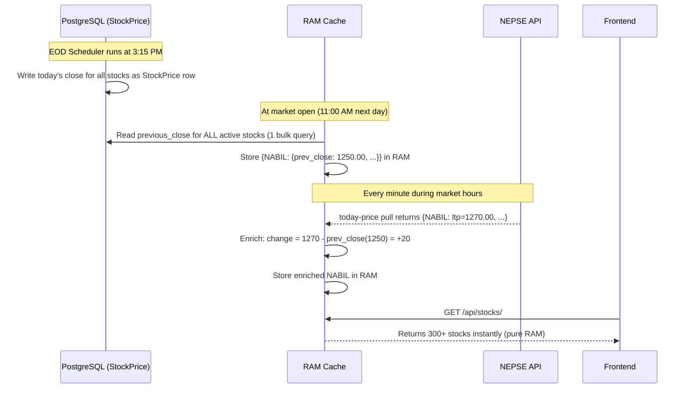
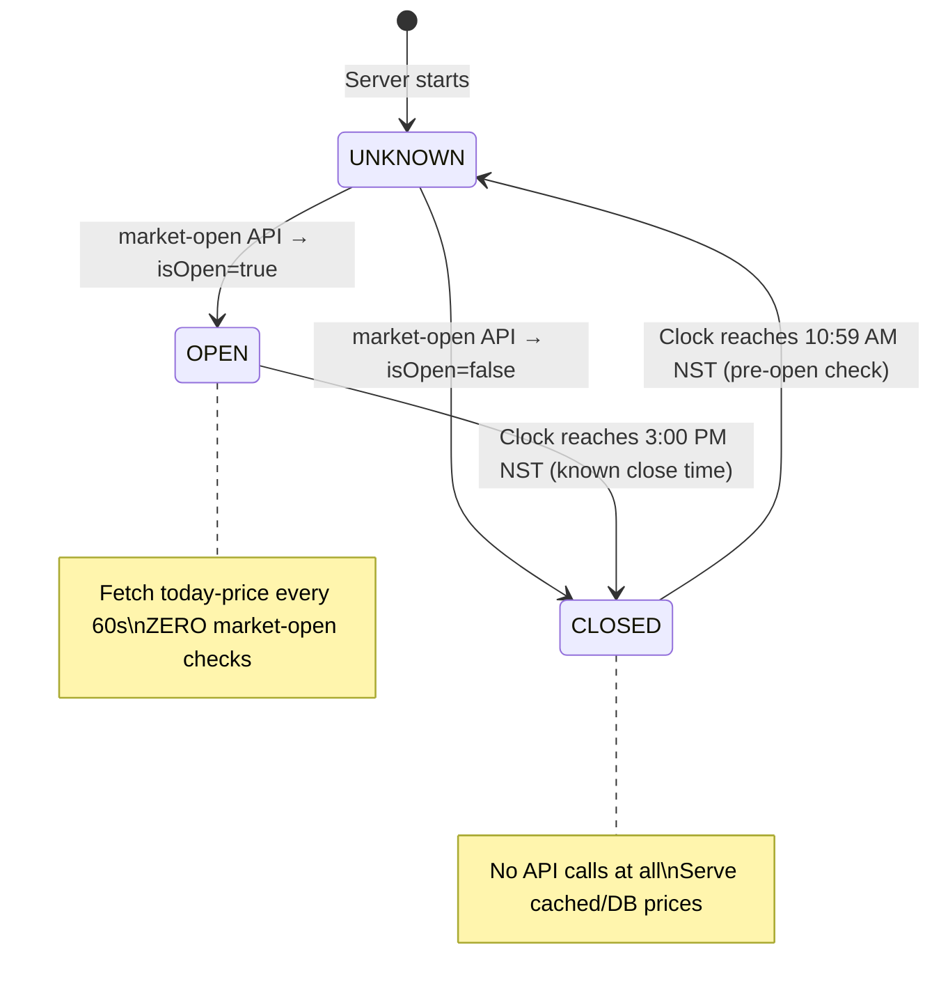

# Research: Cache Architecture & Previous Close Strategy

> **Last updated:** 2026-02-23 — includes trading session gate via `market-open` API.

## 1. Full API & Page Audit: Who Uses the Cache?

### Legend
| Icon | Meaning |
|------|---------|
| ✅ | Uses live in-memory cache (fast, 1 NEPSE API call/min) |
| ❌ | Hits the PostgreSQL database directly (slow, stale) |
| 🔄 | Mixed: initial load from DB, live polling from cache |

---

### Backend API Endpoints

| Endpoint | View Class | Data Source | Notes |
|----------|-----------|-------------|-------|
| `GET /api/stocks/` | [StockListView](file:///home/rabin/Desktop/BCA_Project/backend/stocks_app/views.py#35-46) | ✅ Cache (`get_all_cached_stock_prices`) | Just refactored |
| `GET /api/stocks/top-gainers/` | [TopGainersView](file:///home/rabin/Desktop/BCA_Project/backend/stocks_app/views.py#82-104) | ✅ Cache | Just refactored |
| `GET /api/stocks/top-losers/` | [TopLosersView](file:///home/rabin/Desktop/BCA_Project/backend/stocks_app/views.py#106-123) | ✅ Cache | Just refactored |
| `GET /api/stocks/top-turnover/` | [TopTurnoverView](file:///home/rabin/Desktop/BCA_Project/backend/stocks_app/views.py#125-142) | ✅ Cache | Just refactored |
| `GET /api/stocks/live-price/<symbol>/` | [LiveStockPriceView](file:///home/rabin/Desktop/BCA_Project/backend/stocks_app/views.py#192-230) | ✅ Cache ([get_cached_stock_price](file:///home/rabin/Desktop/BCA_Project/backend/stocks_app/services.py#584-651)) | Already working |
| `GET /api/stocks/market-depth/<symbol>/` | [MarketDepthView](file:///home/rabin/Desktop/BCA_Project/backend/stocks_app/views.py#151-190) | ✅ Cache (NEPSE API, 60s TTL) | Already working |
| `GET /api/stocks/<symbol>/` | [StockDetailView](file:///home/rabin/Desktop/BCA_Project/backend/stocks_app/views.py#25-33) | ❌ **Database** | No cache |
| `GET /api/stocks/search/` | [StockSearchView](file:///home/rabin/Desktop/BCA_Project/backend/stocks_app/views.py#9-23) | ❌ **Database** | Full-text DB search (OK, low freq) |
| `GET /api/stocks/history/<symbol>/` | [StockHistoryView](file:///home/rabin/Desktop/BCA_Project/backend/stocks_app/views.py#232-262) | ❌ **Database** ([StockPrice](file:///home/rabin/Desktop/BCA_Project/backend/stocks_app/models.py#73-90) table) | Correct – historical data belongs in DB |
| `GET /api/sectors/` | [SectorListView](file:///home/rabin/Desktop/BCA_Project/backend/stocks_app/views.py#48-57) | ❌ **Database** | DB query + prefetch_related |
| `GET /api/sub-indices/` | [SubIndexListView](file:///home/rabin/Desktop/BCA_Project/backend/stocks_app/views.py#59-65) | ✅ Cache ([get_cached_sub_indices](file:///home/rabin/Desktop/BCA_Project/backend/stocks_app/services.py#715-777)) | Already via NEPSE API |
| `GET /api/market-indices/` | [MarketIndexListView](file:///home/rabin/Desktop/BCA_Project/backend/stocks_app/views.py#67-73) | ✅ Cache ([get_cached_market_indices](file:///home/rabin/Desktop/BCA_Project/backend/stocks_app/services.py#652-713)) | Already via NEPSE API |
| `GET /api/stocks/market-status/` | [MarketStatusView](file:///home/rabin/Desktop/BCA_Project/backend/stocks_app/views.py#144-149) | ✅ Python calc | No DB hit |

---

### Frontend Pages

| Page | Calls | Cache Status | Problem |
|------|-------|-------------|---------|
| **Dashboard** | [getTopGainers](file:///home/rabin/Desktop/BCA_Project/frontend/src/services/stockService.js#106-115), [getTopLosers](file:///home/rabin/Desktop/BCA_Project/frontend/src/services/stockService.js#116-125), [getTopTurnover](file:///home/rabin/Desktop/BCA_Project/frontend/src/services/stockService.js#126-135) | ✅ Now uses cache | Fixed in last session |
| **Market** | [getAllStocks](file:///home/rabin/Desktop/BCA_Project/frontend/src/services/stockService.js#55-65), [getSectors](file:///home/rabin/Desktop/BCA_Project/frontend/src/services/stockService.js#76-85), [getMarketIndices](file:///home/rabin/Desktop/BCA_Project/frontend/src/services/stockService.js#96-105) | 🔄 Stocks=cache, Sectors=DB, Indices=cache | Sectors are served from DB |
| **MarketMovers** | [getTopGainers](file:///home/rabin/Desktop/BCA_Project/frontend/src/services/stockService.js#106-115), [getTopLosers](file:///home/rabin/Desktop/BCA_Project/frontend/src/services/stockService.js#116-125), [getTopTurnover](file:///home/rabin/Desktop/BCA_Project/frontend/src/services/stockService.js#126-135) | ✅ Uses cache | But no pagination in cache responses currently |
| **StockDetail** | [getDetail](file:///home/rabin/Desktop/BCA_Project/frontend/src/services/stockService.js#17-26) → then [getLiveStockPrice](file:///home/rabin/Desktop/BCA_Project/frontend/src/services/stockService.js#27-41) | 🔄 **Hybrid** | Initial static load is DB. Live polling is cache |
| **Portfolio** | Portfolio API | ❌ DB | Portfolio is user data, DB is correct here |
| **Trading** | Stock lookup + Portfolio | ❌ DB + cache for live price | Live price is cache, trade exec is DB (correct) |
| **OrderHistory** | Portfolio API | ❌ DB | Correct – historical data |
| **StockHistory** | `getHistory` | ❌ DB | Correct – historical OHLCV data |

---

## 2. Root Cause: Why StockDetail is Still Slow

[StockDetail.jsx](file:///home/rabin/Desktop/BCA_Project/frontend/src/pages/Market/StockDetail.jsx) does a **2-step fetch**:
1. **Step 1** ([getDetail](file:///home/rabin/Desktop/BCA_Project/frontend/src/services/stockService.js#17-26)): Calls `GET /api/stocks/<symbol>/` → hits [StockDetailView](file:///home/rabin/Desktop/BCA_Project/backend/stocks_app/views.py#25-33) → raw `Stock.objects.get()` **DB query**.
2. **Step 2** ([getLiveStockPrice](file:///home/rabin/Desktop/BCA_Project/frontend/src/services/stockService.js#27-41)): Calls `GET /api/stocks/live-price/<symbol>/` → hits the in-memory cache.

So the page renders with stale DB data *first*, then updates with live data *second*. One NEPSE fetch every 60s is correct — but the initial DB hit is redundant and slower than needed.

> **Fix**: [StockDetailView](file:///home/rabin/Desktop/BCA_Project/backend/stocks_app/views.py#25-33) should read from the cache using `get_all_cached_stock_prices` and merge with static metadata (name, sector, etc.) — exactly the same as we now do for the list view. Step 2 (the live price polling every 60s) should remain unchanged.

---

## 3. Root Cause: Why Sectors are Slow

[SectorListView](file:///home/rabin/Desktop/BCA_Project/backend/stocks_app/views.py#48-57) does a `Sector.objects.prefetch_related('subindex').annotate(stock_count=Count('stocks'))` which is a heavy DB aggregate query every time any page with a sector dropdown loads.

Sectors only change if a new company IPO happens (very rare). They should be cached for a long TTL (1 hour or even until the next `sync_companies` run).

---

## 4. The `previous_close` Problem — How Real Broker Firms Work

### How NEPSE / NSE / BSE define Previous Close

Real broker firms (Zerodha, Angel One, NSE India) define `previous_close` with absolute precision:

> **`previous_close` = The official closing price of the last completed trading session.**

This sounds simple, but it has several implications:

| Scenario | `previous_close` |
|----------|-----------------|
| Today is a trading day, market is OPEN | Close price of **yesterday** |
| Today is a trading day, market is CLOSED (EOD) | Close price of **today** (which just became yesterday's) |
| Today is a holiday / weekend | Close price of the **last trading day before today** |
| Stock is dormant (no trades for 30 days) | Close price of **the last day it actually traded** |

The NEPSE API's `previousDayClosePrice` field in `today-price` is **NOT reliable** for the following reasons we discovered in earlier debugging:
- It is sometimes `null` or missing for dormant stocks.
- It sometimes equals the current LTP (meaning it wasn't populated correctly by NEPSE).

### How We Should Define It

Our most trustworthy source for `previous_close` is our **own [StockPrice](file:///home/rabin/Desktop/BCA_Project/backend/stocks_app/models.py#73-90) table** — specifically the `close` price of the last entry per symbol.

```
previous_close(STOCK X, TODAY) = 
    SELECT close FROM StockPrice 
    WHERE stock_id = X 
    ORDER BY timestamp DESC 
    LIMIT 1;
```

This is populated every EOD by our EOD scheduler. This data is ours, it's clean, and it doesn't depend on NEPSE's API reliability.

---

## 5. The Proposed Architecture (Real Broker Pattern)

This is how Zerodha, Upstox, and NSE's own feeds work at a high level, adapted to our stack:



### Key Design Insight
The `previous_close` **does not change during a trading day**. It is constant from 11:00 AM to 3:00 PM. So it should be read ONCE from the DB at the start of the day, stored in RAM, and then used to calculate [change](file:///home/rabin/Desktop/BCA_Project/backend/stocks_app/admin.py#16-20) for every subsequent NEPSE pull — without ever touching the DB again.

---

## 6. Current Bug: Where `previous_close` is Wrong in the Cache

In [_refresh_global_stock_cache()](file:///home/rabin/Desktop/BCA_Project/backend/stocks_app/services.py#490-582) (Phase 2), we currently do:

```python
'previous_close': safe_decimal(
    stock.get('previousDayClosePrice') or stock.get('previousClose')
),
```

This reads `previous_close` from the NEPSE API response, which is unreliable. When NEPSE gives a wrong or null value, we store the wrong `previous_close` in our cache, which then causes wrong [change](file:///home/rabin/Desktop/BCA_Project/backend/stocks_app/admin.py#16-20) calculations.

**What we SHOULD do instead:**
1. At cache warm-up (once per minute cycle), do a single bulk DB query: fetch the latest `StockPrice.close` for each active symbol.
2. Store this in a separate `prev_close_map: {symbol -> close_price}` cache entry with a long TTL (24h or until EOD scheduler updates it).
3. When processing the NEPSE `today-price` response, use `prev_close_map.get(symbol)` instead of the unreliable API field for `previous_close` and [change](file:///home/rabin/Desktop/BCA_Project/backend/stocks_app/admin.py#16-20) calculations.

---

## 7. What Needs to be Fixed (Priority Order)

| # | Fix | Impact | Source of Truth |
|---|-----|--------|-----------------|
| 1 | **`previous_close` reliability** | Fixes wrong change values everywhere | [StockPrice](file:///home/rabin/Desktop/BCA_Project/backend/stocks_app/models.py#73-90) table latest `close` |
| 2 | **[StockDetailView](file:///home/rabin/Desktop/BCA_Project/backend/stocks_app/views.py#25-33) uses cache too** | Removes DB hit on initial stock page load | Cache + DB metadata join |
| 3 | **[SectorListView](file:///home/rabin/Desktop/BCA_Project/backend/stocks_app/views.py#48-57) is cached** | Faster sector dropdown loading | Long-TTL cache (1h) |
| 4 | **EOD Scheduler writes [StockPrice](file:///home/rabin/Desktop/BCA_Project/backend/stocks_app/models.py#73-90)** | Ensures prev_close has data every day | NEPSE `today-price` at 3:15 PM |

> [!IMPORTANT]
> The most impactful fix is #1. If `previous_close` comes from our DB (`StockPrice.close`), then `change = NEPSE_LTP - our_previous_close` will always be accurate. This eliminates the dependency on the unreliable `previousDayClosePrice` field from NEPSE entirely.

> [!NOTE]
> **Why we CANNOT just use the DB `Stock.previous_close` field directly from the cache refresh:**
> The `Stock.previous_close` field on the main [Stock](file:///home/rabin/Desktop/BCA_Project/backend/stocks_app/models.py#46-71) table is set by `sync_companies`, which only runs on startup. If a user doesn't restart the server, that field stays stale. The [StockPrice](file:///home/rabin/Desktop/BCA_Project/backend/stocks_app/models.py#73-90) table, populated by the EOD scheduler every day, is the correct, always-fresh source.

---

## 8. The EOD Scheduler — Current State

The EOD scheduler must be verified to ensure it:
1. Runs at the correct local Nepal time (after 3:00 PM NST market close).
2. Actually writes one [StockPrice](file:///home/rabin/Desktop/BCA_Project/backend/stocks_app/models.py#73-90) row per active stock.
3. Uses the `today-price` API (not the [security_details](file:///home/rabin/Desktop/BCA_Project/backend/venv/lib/python3.12/site-packages/nepse_data_api/market.py#538-556) individual fetch, which is too slow for 300 stocks at EOD).

If the EOD scheduler is working correctly, then [StockPrice](file:///home/rabin/Desktop/BCA_Project/backend/stocks_app/models.py#73-90) is already populated and we simply need to start reading from it for `previous_close`.

---

## 9. Market-Open API — Robust State Machine Design

### The Problem with [market_hours.py](file:///home/rabin/Desktop/BCA_Project/backend/stocks_app/market_hours.py)

The current [market_hours.py](file:///home/rabin/Desktop/BCA_Project/backend/stocks_app/market_hours.py) uses a **hardcoded Python clock check**. It has one fatal flaw:

> **It cannot know about public holidays.**  
> If NEPSE declares a holiday, our system will think the market is open and burn API calls for no reason.

### The NEPSE API

NEPSE provides an official authoritative endpoint already wrapped in our library:

```python
nepse.get_market_status()   # → GET /api/nots/nepse-data/market-open
# Returns: {"isOpen": true} or {"isOpen": false}
```

---

### The Robust Pattern: Call Once, Stay in State

> [!IMPORTANT]
> Checking the API every minute is wasteful and wrong. Once you know the market is **OPEN**, there is no reason to keep asking if it's still open — you already know it runs until 3:00 PM. Once you know it's **CLOSED**, there is zero reason to keep asking — the exchange does not change its mind during closing hours.

This is a classic **State Machine**:



### The Three States

| State | Trigger | Behaviour | API Calls to NEPSE |
|-------|---------|-----------|---------------------|
| `UNKNOWN` | Server start or 10:59 AM NST | Call `market-open` API **once** to resolve | 1 call total |
| `OPEN` | `isOpen = true` confirmed | Fetch `today-price` every 60s. **Never check market-open again.** | 1 call/min (today-price only) |
| `CLOSED` | `isOpen = false` OR clock hits 3 PM | **Zero API calls.** Serve last cached prices. | 0 |

### The Key Insight: Clock as the Transition Trigger

The `market-open` API is only called **once per session transition**. After that, the local clock is sufficient to know when to transition:

- Once `OPEN` is confirmed: the market will close at exactly **3:00 PM NST**. Lock the transition to that time. No need to ask NEPSE again.
- Once `CLOSED`, the market might open at **11:00 AM NST** on the next trading day. At **10:59 AM NST** call `market-open` once to confirm (handles holidays — if it's a holiday, `isOpen` will still be false, stay in CLOSED).

```
State UNKNOWN
  └─ Call market-open API once
      ├─ isOpen=true  → Enter OPEN state, start 1/min today-price polling
      └─ isOpen=false → Enter CLOSED state, serve existing cache/DB (no polls)

State OPEN
  └─ Every 60s: fetch today-price → populate cache
  └─ At 3:00 PM NST clock alarm → transition to CLOSED (no API call needed)

State CLOSED  
  └─ Zero API calls all evening/night/holiday
  └─ At 10:59 AM NST → call market-open API once → back to UNKNOWN
```

### Why This Is Better

| Approach | Calls to market-open on a holiday | Calls during trading hours |
|----------|------------------------------------|---------------------------|
| Old (check every minute) | 60×7 = 420 wasted calls/day | 240 calls/session |
| **New (state machine)** | **1 call (then stays CLOSED)** | **1 call (then stays OPEN)** |

### Implementation

1. **Cache the market state** (`cache.set("market_state", "OPEN"/"CLOSED"/"UNKNOWN", ttl)`) with:
   - State `OPEN`: TTL = seconds until 3:00 PM NST
   - State `CLOSED`: TTL = seconds until 10:59 AM NST next trading day
   - State `UNKNOWN`: TTL = 0 (resolved immediately)

2. **[_refresh_global_stock_cache()](file:///home/rabin/Desktop/BCA_Project/backend/stocks_app/services.py#490-582)** checks this state key first (LocaL RAM - free). Only fetches today-price if state is `OPEN`.

3. **[MarketStatusView](file:///home/rabin/Desktop/BCA_Project/backend/stocks_app/views.py#144-149)** reads the same cache key. Frontend gets a correct `CLOSED` on holidays without clock guessing.

4. The **EOD scheduler** (runs at 3:15 PM) writes the [StockPrice](file:///home/rabin/Desktop/BCA_Project/backend/stocks_app/models.py#73-90) row, then flips state to `CLOSED` immediately — no need to wait for cache expiry.
